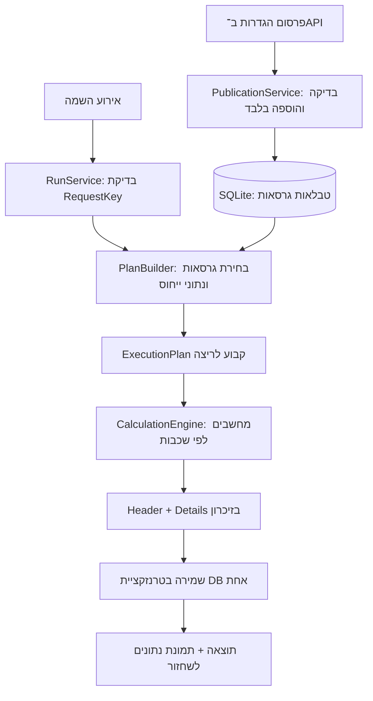

# להבין את הקוד

## היכן קוראים כל דבר

| קובץ/תיקייה תחת src/Payments.Api | אחריות |
|---|---|
| `Program.cs` | הרכבת השירותים, נתיבי API וטיפול בשגיאות |
| `Domain/Entities.cs` | מחלקות המייצגות טבלאות |
| `Domain/Contracts.cs` | בקשות API ותוכנית חישוב |
| `Infrastructure/EngineDb.cs` | קשרים, אינדקסים, שמירת decimal וטריגרים נגד שינוי היסטוריה |
| `Infrastructure/DemoSeed.cs` | נתוני ההדגמה בלבד |
| `Services/PublicationService.cs` | פרסום רכיב/מודל/הסכמה/מחירון, ולידציה וכיסוי תוקף |
| `Services/PlanBuilder.cs` | בחירת מודל לפי הסכמה ורכיב לפי תאריך ומספר גרסה |
| `Services/CalculationEngine.cs` | חמשת מחשבי הרכיבים, צבירת פירוט ו־Trace |
| `Services/RunService.cs` | מניעת כפל, שמירה אטומית ושחזור |
| `wwwroot/` | דף מנהלים בעברית; כל הנתונים מגיעים מה־API |

## למה גרסה נוספת אינה קוד חדש

מחשב אחזקה מכפיל מחיר בפרמטר Factor. את Factor מחזיקים בטבלת ComponentItem, שמחוברת לגרסת רכיב מסוימת. גרסה חדשה מוסיפה מפרט חדש; היא לא יוצרת פונקציית C# חדשה. באחזקה 90% נכתב `0.9`, בכוח אדם משרה של עשירית נכתבת `0.1`.

סוג חישוב חדש כן דורש מימוש `IComponentCalculator`, הרחבת הפרסום ובדיקות. שינוי התנהגות של תבנית קיימת מחייב גרסת TemplateVersion חדשה, שמירת המימוש הישן והוספת ניתוב מפורש. כרגע המערכת מקבלת רק v1 ודוחה אחרות.

## איך הטבלאות בזיכרון עובדות

אין צורך במבנה Data Grid של SAS. `TransactionHeader` הוא אובייקט C# משותף ובתוכו `List<TransactionDetail>`. כל מחשב מוסיף שורות לרשימה. רווח ומס מסננים את הקודמות; המנוע אינו שומר באמצע ואינו מבצע REST פנימי. בסוף EF שומר את כל הגרף יחד.

פלט עסקי Pending שונה ממצב הריצה Completed: החישוב הושלם, אך התשלום עדיין לא מאושר או משולם. המערכת אינה מבצעת תשלום.

## snapshot ומקביליות

PlanBuilder קורא את כל ההגדרות בתוך טרנזקציית קריאה אחת. התוכנית כוללת את המחירים, ההסכמים והמס שנבחרו — אין שליפות חדשות בזמן הפעלת המחשבים. פרסום מאוחר לא משנה את התוכנית הזאת.

SQLite מיועד כאן לתהליך שרת מקומי אחד. WriterGate מסדר כתיבות בתוך התהליך, וב־DB קיימים אילוצי ייחודיות. אין לטעון שהמערכת כבר מוכנה לאשכול שרתים: צריך מעבר ל־PostgreSQL/SQL Server או תכנון נעילות/ריטריי מתאים ובדיקות נוספות.
