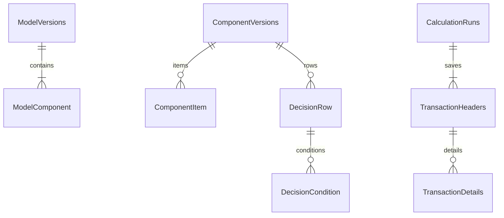

# טבלאות: מה נשמר והיכן

## הגדרות

| טבלה | תוכן | מפתח עסקי |
|---|---|---|
| ComponentVersions | סוג, גרסה, תוקף, שיוך ותבנית | ComponentId + Version |
| ComponentItem | פריטי מחירון ומקדמי חישוב של גרסת רכיב | FK לגרסת רכיב |
| DecisionRow | שורות סל, סכום או פריט מחירון | FK לגרסת רכיב + RowKey |
| DecisionCondition | תנאי השורה: מאפיין, אופרטור וערכים | FK לשורת החלטה |
| ModelVersions | גרסת מודל ותוקפה | ModelId + Version |
| ModelComponent | שיוך ComponentId לשכבה וסדר בגרסת מודל | FK למודל + ComponentId |
| Consents | הסכמת מסגרת למודל מתאריך | Institution + ModelId + EffectiveFrom |
| PriceVersions | מחיר ותקופת תוקף | PriceKey + Version |
| AgreementVersions | אחוז רווח מוסכם למסגרת | Institution + Version |
| TaxRateVersions | שיעור מס לפי בעלות וסוג רכיב מקור | Ownership + SourceKind + Version |

ComponentId במודל אינו מפנה לגרסה קבועה. השרת בוחר את הגרסה בזמן ריצה. ההפניה הלוגית הזאת נבדקת בפרסום ובחישוב; היא אינה FK SQL ישיר ל־ComponentVersions, מפני שיש כמה שורות לאותו ComponentId.

## תוצאות

| טבלה | תוכן |
|---|---|
| CalculationRuns | RequestKey ייחודי, hash קלט, הקלט, תמונת התוכנית ותוצאה סופית ב־JSON, זמן וגרסת מנוע |
| TransactionHeaders | כותרת אחת לבקשה: השמה, מסגרת, חודש, גרסת מודל וסכום |
| TransactionDetails | רכיב וגרסה, שכבה, פריט, סכום, חבויות והסבר |

תוצאות עסקיות הן טבלאות מובנות. JSON נשמר כתמונת audit ושחזור, לא במקום מפרטי רכיבים טבלאיים. SQLite שומר מספרים כספיים כטקסט עשרוני באמצעות converter; החישוב והסיכום מתבצעים ב־C# decimal. אין לבצע SUM/ORDER מספרי ישיר על עמודות הטקסט בלי המרה מתאימה; מעבר לשרת DB יאפשר numeric אמיתי.

## הגנות בפועל

אילוצי ייחודיות, מפתחות זרים וטריגרים האוסרים UPDATE/DELETE של ההיסטוריה. השרת מספק POST לפרסום בלבד, לא PUT למחיקת עבר. זו אינה אבטחה מול בעל גישה מלאה לקובץ ה־DB, שיכול לשנות את הסכמה/למחוק קובץ; ייצור מחייב הרשאות וגיבוי.

אין טבלת Models או Components לוגית נפרדת ב־POC: הישות הלוגית היא קבוצת שורות לפי ModelId/ComponentId. שינוי טיפוס רכיב תחת אותו מזהה נדחה.
