# Calculation and Rules Engine Architecture

A system architecture document describing the `zen-versioned-engine` project, from a single calculation component through model publication, placement intake, monthly calculation, and retroactive recalculation. The implementation is a C# POC on .NET 10, using GoRules.ZenEngine version 2.1.8.

The diagrams describe the existing implementation. Wherever an additional capability or business decision is required, it is explicitly identified. This document does not certify production readiness or complete coverage of every future component type.

---

## Stage 1 Calculation Component Structure

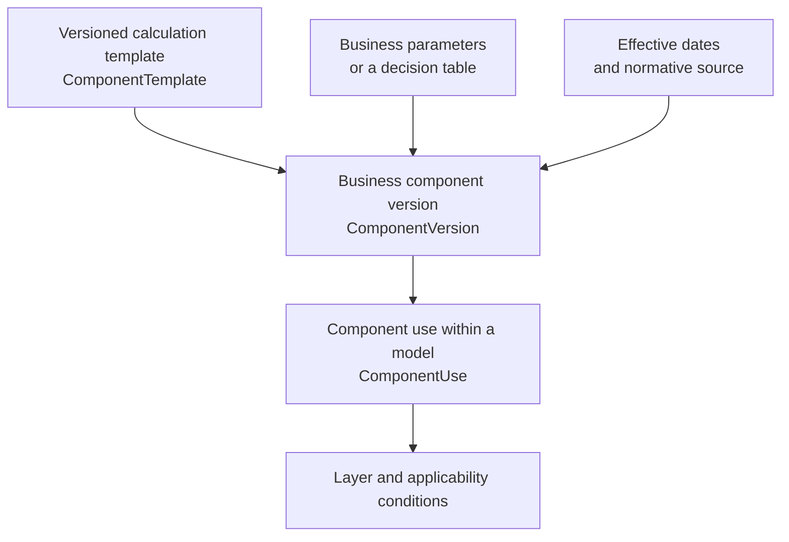

### Three Definitions with Different Responsibilities

| Definition | Contents | Example |
|---|---|---|
| Calculation template `ComponentTemplate` | Input contracts, calculation steps, output structure, and explanation template | Percentage applied to a filtered and grouped basis |
| Component version `ComponentVersion` | Business identifier, version, template-version reference, parameters, effective dates, and source reference | Profit at a rate of 4 percent |
| Component use `ComponentUse` | Use identifier, component identifier, layer, and applicability conditions | Executing the profit component in layer 6 |

A component retains its business identity across versions through `Id`. The current database has no separate parent entity for a component; versions sharing the same identifier represent the same component.

### Example Profit Component Version

```json
{
  "id": "profit",
  "version": 1,
  "name": "Profit",
  "templateId": "aggregate",
  "templateVersion": 1,
  "from": "2026-01-01",
  "to": "2027-12-31",
  "parameters": {
    "basis": "profit",
    "rate": 0.04,
    "kind": "Profit",
    "tax": "Private"
  },
  "source": "Example agreement profit clause",
  "table": null,
  "supersedes": null
}
```

This definition is not a new C# algorithm. It references an existing template and supplies parameters. Publishing it does not create a payment.

### Execution Contract for Every Component

- **Receives:** Effective-dated facts, a calculation segment, parameters, reference data, and lines from previous layers.
- **Returns:** Zero or more proposed payment lines and a structured trace; failure produces a business error.
- **Does not perform:** Retrieval from source systems, independent database writes, or access to the results of another component in the same layer.

Contract implementation: [Definitions.cs](../src/Rules.Domain/Definitions.cs).

## Stage 2 Template Execution and the Boundary with ZEN

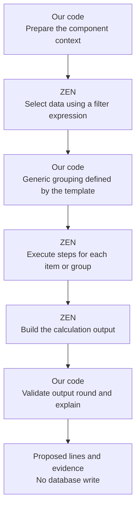

### Contents of a Template Definition

| Field | Purpose |
|---|---|
| `Parameters` | Schema for component-version parameters |
| `Facts` | Schema for event fields required by the component |
| `ForEach` | ZEN expression selecting the collection to process |
| `GroupBy` | Field names for generic grouping in .NET, when required |
| `Steps` | List of steps, each with a name, expression, and optional assertion |
| `OutputExpression` | ZEN expression returning an array of lines |
| `Explanation` | Hebrew explanation template |
| `TableOutputs` | Decision-table output column types and roles |
| `Collections` | Specification-item contracts and references to reference data |

### Data Context Passed to Expressions

| Name | Contents |
|---|---|
| `facts` | The segment's fact snapshot |
| `p` | Component-version parameters |
| `period` | Segment start and end, days, and partial-month factor |
| `refs` | Reference data selected by date, including identifiers and versions |
| `previous` | Payment lines from previous layers only |
| `tableRows` | Decision-table output, if present |
| `item` | The current item, or a group containing `key` and `rows` |
| `s` | Results of steps already executed for the current item |

### Focused Profit Component Example

An excerpt from the existing template, not a complete publication package:

```json
{
  "forEach": "filter(previous, (p.basis == 'profit' and #.profitRequired) or (p.basis == 'tax' and #.tax == facts.ownership))",
  "groupBy": ["group"],
  "steps": [
    {"key": "basis", "expression": "sum(map(item.rows, #.amount))"},
    {"key": "basisKeys", "expression": "map(item.rows, #.key)"},
    {"key": "rate", "expression": "p.rate"},
    {"key": "amount", "expression": "s.basis * s.rate"}
  ],
  "outputExpression": "[{itemId: p.kind, group: item.key, kind: p.kind, amount: s.amount, profitRequired: false, tax: p.tax, basisKeys: s.basisKeys}]",
  "explanation": "Basis {basis} × rate {rate} = {amount}"
}
```

ZEN filters the lines subject to profit. Our grouping adapter partitions those lines by `group`. For each group, ZEN calculates the basis, reads the rate from the parameters, and multiplies them. The rate in this example is not inferred automatically; it is `p.rate`.

Numerical example: Two eligible lines, 1,000 and 1,800, produce a basis of 2,800. A rate of 0.04 produces profit of 112. A line not subject to profit is excluded from the basis.

### Actual Library Invocation

```csharp
var compiled = ZenExpression.Compile(expression);
var output = compiled.Evaluate(new JsonBuffer(contextJson));
```

The adapter caches compiled expressions, avoiding recompilation on every execution. The output is a `JsonBuffer` converted into a JSON value. Each step receives the context and the results of previous steps; our code controls step order.

**Grouping decision:** No built-in dynamic grouping operation was verified in version 2.1.8. Attempts to use `groupBy`, `group_by`, and `group` failed in practical testing. A full chain in ZEN succeeded when the group list was supplied in advance, but that does not replace dynamic grouping without a coverage check. Grouping therefore remains a shared LINQ adapter; filtering, summation, and the formula remain in ZEN.

Code: [ComponentExecutor](../src/Rules.Application/Execution/ComponentExecutor.cs), [ZenRuleRuntime](../src/Rules.Infrastructure/Rules/ZenRuleRuntime.cs). Definition: [aggregate.v1.json](../examples/templates/aggregate.v1.json).

## Stage 3 Decision Table Component

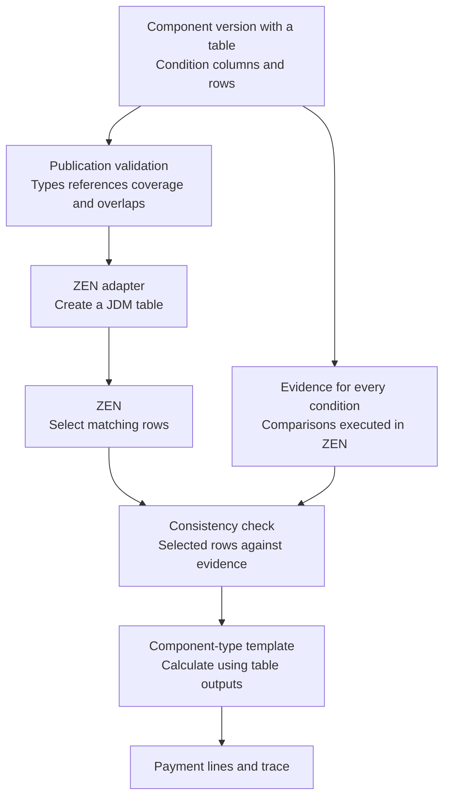

The table is versioned business data. It contains conditions and output values; the formula combining the outputs belongs to the component-type template.

### Table Structure

- Condition column: `Id`, a known input field, and a type.
- Row: A stable identifier, an explicit condition for every column, outputs, and a normative source.
- Hit policy: `unique`, `first`, or `collect`.
- No-match policy: `zero` or `error`.
- `AllowOverlap`: Explicit approval of intentional overlaps under `collect`.

| Output role | Example |
|---|---|
| `value` | Amount selected from the table |
| `reference` | Price-list item identifier |
| `multiplier` | Calculation factor |
| `input` | Quantity field name from the event contract |
| `override` | Amount overriding the regular calculation |

In the emergency scenario, the template specifies: Use Override when present; otherwise calculate price × multiplier × quantity. This is template logic, not a free-form formula inside a cell.

### Required Semantics in the Implementation

- `any` means any value; `missing` means a missing value. An empty cell has no implicit meaning.
- `between` includes both endpoints. `in` receives a typed array.
- The number `18` is not the string `"18"`.
- Condition columns may change between component versions within the template's facts contract.
- Output columns are validated against the template version; a change in meaning requires an appropriate template version.
- Dates are retained as ISO values in the evidence and adapted to numeric day values when executing the table in ZEN.

`unique` is implemented by collecting matches and enforcing their count in our code; the library itself receives `collect`. This prevents an overlap from being hidden by selecting the first row.

Static analysis targets the restricted condition language in the contract. It is limited to 100,000 combinations of equivalence classes and a budget of two million estimated condition checks. A table exceeding the limit is rejected. This is not a general coverage analyzer for unrestricted programming expressions.

Code: [DefinitionValidator](../src/Rules.Application/Publication/DefinitionValidator.cs), [DecisionTableAnalyzer](../src/Rules.Application/Publication/DecisionTableAnalyzer.cs).

## Stage 4 Payment Lines Ledger Transactions and Explanations

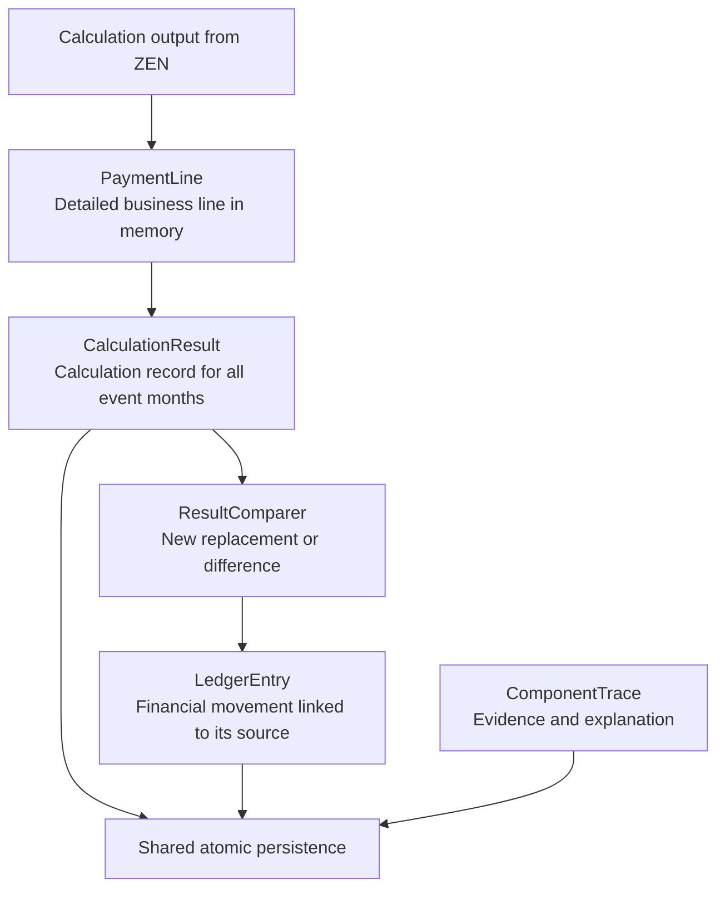

A calculation line must be distinguished from a payment-ledger movement. The same calculated result may create a Pending movement, a replacement of a planned payment, or an adjustment, depending on the previous state.

| Structure | Main fields |
|---|---|
| `PaymentLine` | Business key, component and version, use and layer, item and group, payment kind, profit and tax applicability, raw amount, rounded amount, explanation, `TraceId`, basis lines |
| `LedgerEntry` | Movement identifier, run, placement, month, line key, amount, movement kind, `OriginalEntryId`, `TraceId` |
| `MonthlyPosition` | Placement, month, latest target run, and whether the month has already been marked as paid |

The model version and agreement are stored in the segment within the run record; they are not copied into every `LedgerEntry`. Links through `RunId` and `TraceId` provide the full context.

**Profit example:** `RawAmount=112`, `Amount=112.00`, `ProfitRequired=false`. In an initial calculation, a `Pending` movement of 112 is created. The generated explanation is: “Basis 2800 × rate 0.04 = 112.00.”

The current business key includes the component use, item, group, and segment boundaries. It excludes the component version so that amounts can be compared across versions. A change in segment boundaries may appear as removed lines and newly added lines.

Structure definitions: [Results.cs](../src/Rules.Domain/Results.cs).

## Stage 5 TRACE Structure and Historical Calculation Retrieval

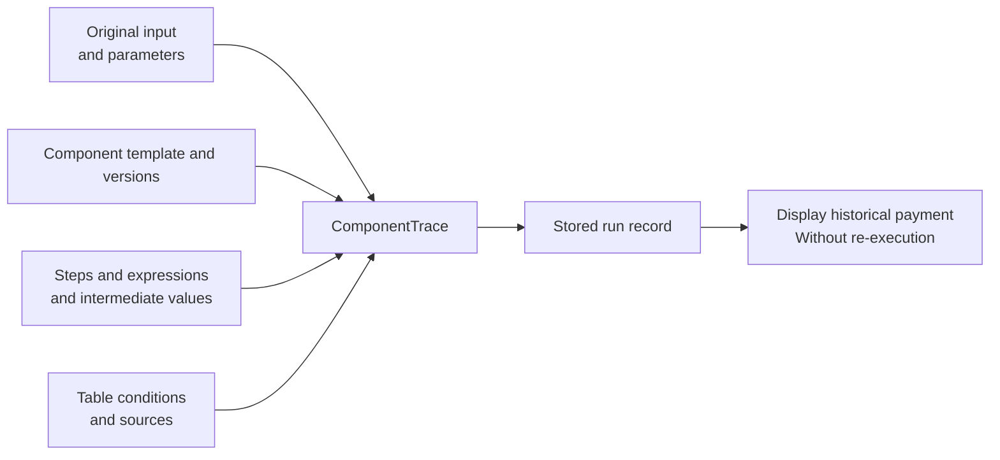

### What Is Stored

- Component, use, and template identifiers and the selected versions.
- Layer, segment, and status: Calculated, Zero, or Skipped.
- The component's input context and step results.
- For every step: Name, expression, and returned value.
- For tables: Row identifier, evaluated values, condition result, and row source reference.
- Rounding policy and normative source.
- At run level: Model and agreement selection, engine version, ZEN version, and catalog hash.

### Who Produces the Evidence

For expression execution, our code builds the trace from ZEN invocation results. For a decision table, the library's native trace is also retained. The Hebrew business explanation is generated from a template substituting step values and is stored in PaymentLine.

**Current limitation:** For regular filtering, such as selecting a profit basis, the input and selected group are retained, but a separate acceptance or rejection decision is not stored for every source line. The `ForEach` expression is also not recorded as a separate step entry; it remains available in the published template. Detailed evidence for each rejected line is an additional requirement if mandated by the business contract.

A historical payment is retrieved using `GET /api/runs/{runId}`. No old code version needs to be executed. Reconstructing placement state for retroactive recalculation also requires reliable history from the source system; a payment trace does not replace the complete placement history.

## Stage 6 Version and Time Management

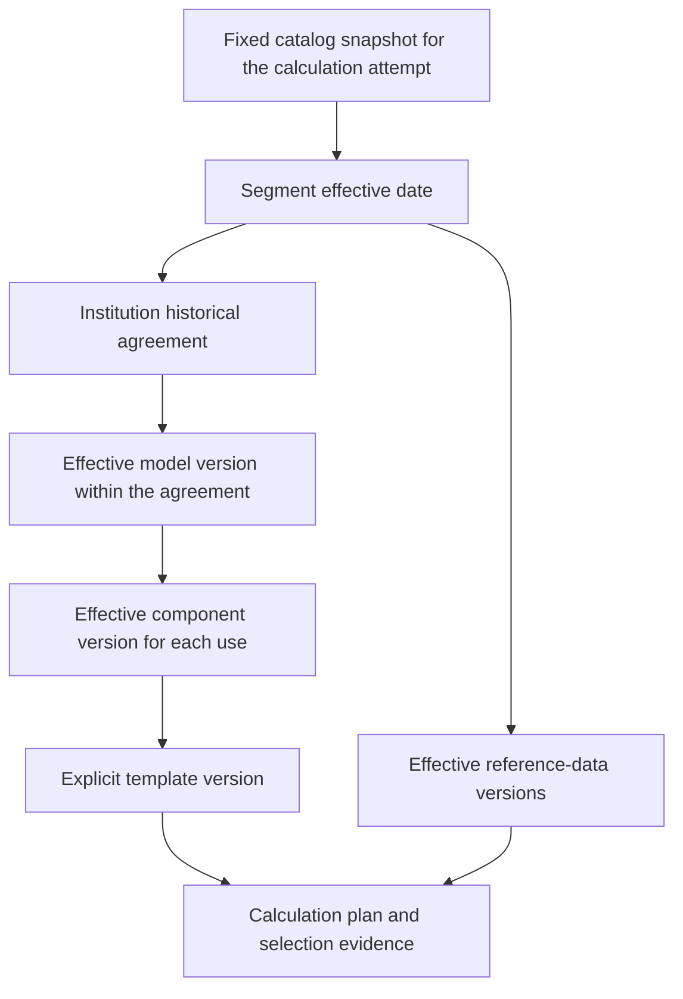

| Version type | Key and selection |
|---|---|
| Template | Identifier and version number, explicitly specified by the component |
| Component | Business identifier and version number; highest effective version on the date |
| Model | Identifier and version number; highest effective version within the selected agreement |
| Institution consent | Institution, model, effective dates, and version; highest effective version |
| Reference data | Identifier and version number; highest effective version |
| Engine and library | Recorded in the run record for audit purposes |

### Effective-Date and Precedence Rules

1. Start and end dates are inclusive.
2. Published versions are not edited; changes create another version.
3. A new component, model, or reference-data version must satisfy the version ordering enforced by validation.
4. An overlapping component or reference-data correction requires `Supersedes`; the same applies to overlapping models within the same agreement and overlapping institution consents.
5. At runtime, the mechanism selects the highest effective version number. `Supersedes` is a replacement declaration checked during publication, not a complex runtime precedence graph.
6. X and X+1 may cover the same dates: The institution's agreement is selected before the model version.

### Business Time versus Knowledge Time

Effective dates determine the business period to which a version applies. Publication receipts and snapshots retain the order in which information became known to the system. A calculation record retains the definitions actually selected.

**Current boundary:** No general API has been built to select a catalog “as known at a particular time.” Regular retroactive recalculation uses the current catalog according to effective dates. Retrieval of the original payment uses the stored run record.

A bulk bug fix that preserves stored historical results and identifies all affected records requires an additional patch policy and impact analysis; a new template version must not be interpreted as automatically implementing that process.

Code: [VersionResolver](../src/Rules.Application/Versioning/VersionResolver.cs).

## Stage 7 Publishing a New Component or Component Version

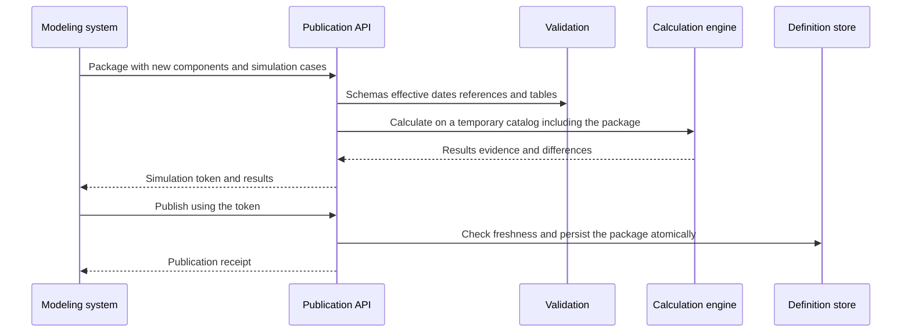

### Three Extension Paths

| Need | What is published | Is new code required |
|---|---|---|
| Another business component using an existing template | `ComponentVersion` with a new identifier | No |
| Parameter change in a component | Same identifier, new version, and effective dates | No |
| New logic using supported operations | New `ComponentTemplate` or version, and a component using it | Not necessarily; definition and testing are required |
| Algorithm outside the contract or permitted operations | Adapter or contract extension | Yes, as a focused extension |

A new template's ZEN expressions are also checked for compilation before simulation cases execute. A price-list reference is checked across the component's effective period when declared in the specification schema or an appropriate output column. There is no complete static analysis of every dynamic reference within an unrestricted expression.

### Publication Contract

`POST /api/publications/preview` receives `PublicationPreviewRequest` containing:

- `package`: Request identifier, publisher, new templates, new components, new models, reference data, and consents.
- `cases`: Between 1 and 30 simulation cases.

The response includes results, differences, affected models, a token, and a validity period of 30 minutes. Calling `POST /api/publications/publish` with the token verifies that the catalog and monthly positions have not changed.

The package is persisted in full or not at all. Repeating publish with the same token returns the original publication receipt. There is no general contract for resubmitting the same package to preview after publication; an already published publication identifier is rejected there.

**Publication does not trigger retroactive recalculation and does not change existing payments.** Editing a JSON file in the examples directory alone does not publish it to the engine.

Business approval belongs to the modeling system. In local mode, the `Publisher` field is reported text, not an authenticated organizational identity.

## Stage 8 Model Structure and Model Versions

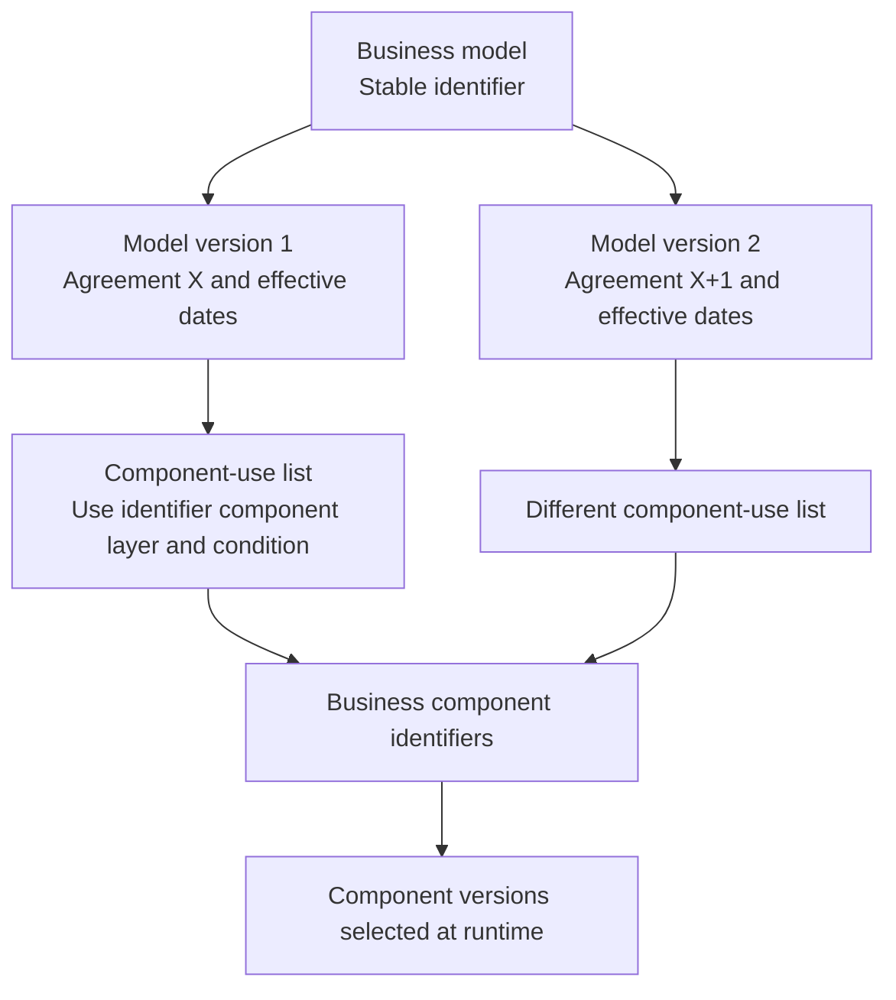

### Abbreviated Model Example

```json
{
  "id": "housing",
  "version": 1,
  "name": "Housing model",
  "agreement": "X",
  "from": "2026-01-01",
  "to": "2027-12-31",
  "components": [
    {"id": "maintenance", "componentId": "maintenance", "layer": 1, "conditions": []},
    {"id": "human", "componentId": "human", "layer": 1, "conditions": []},
    {"id": "profit", "componentId": "profit", "layer": 6, "conditions": []},
    {"id": "tax", "componentId": "tax", "layer": 7, "conditions": []}
  ],
  "source": "Example approved model",
  "supersedes": null
}
```

A model references `ComponentId`, not a component version. A new component version can therefore apply to multiple models using that component without republishing them.

A model version contains its complete component-use list. The use identifier within the model is separate from the component identifier: It allows multiple uses of the same template and distinguishes lines for retroactive comparison.

Applicability conditions are evaluated generically. Components in the same layer may execute together; selecting only one component is not required unless the model conditions specify it.

## Stage 9 Publishing a New Model or Model Version

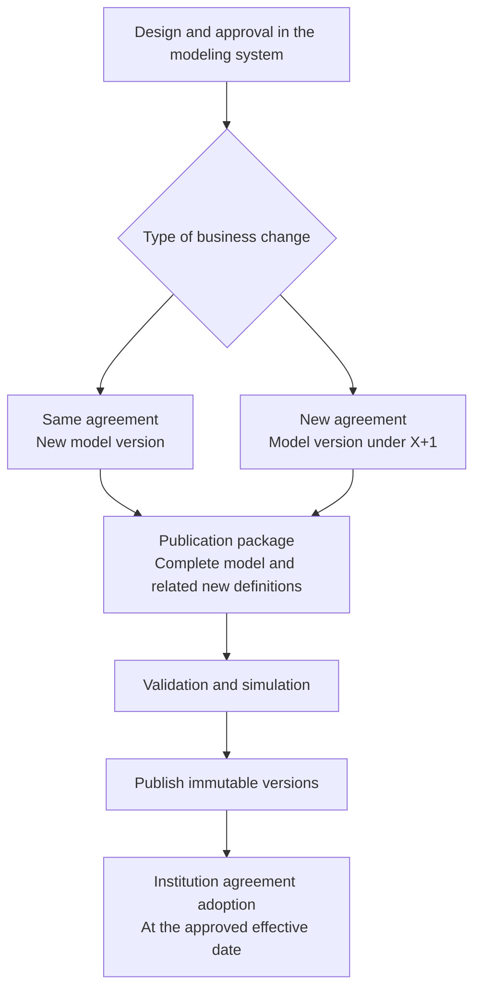

### Composition Rules

- New model: New model identifier and first version.
- Change to composition, layers, or applicability conditions: A new model version with the complete list.
- Overlapping correction within the same agreement: `Supersedes` is required by validation.
- Material change requiring consent: A new agreement and institution adoption history; classification is a human decision.
- If a material component change requires the old behavior to remain available concurrently, a separate component identity must be used according to business policy, rather than changing a shared component indiscriminately across all models.

The package contains the new model version and only the unpublished templates and components it requires. References to existing definitions do not require resending those definitions. Submitting an existing version as a new definition is rejected to preserve immutability.

Agreement adoption and model publication are different business actions. The existing API permits consents to be included in a publication package, but this does not replace the Backoffice process approving adoption.

## Stage 10 Placement Intake into the Engine

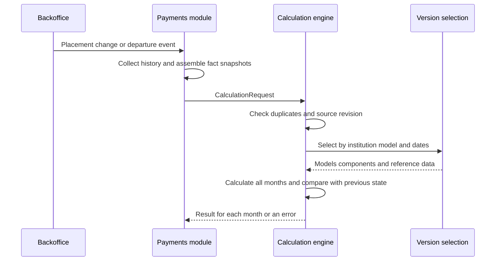

### Example Input

```json
{
  "eventId": "placement-event-001",
  "placementId": "placement-1",
  "institutionId": "institution-a",
  "modelId": "housing",
  "from": "2026-09-01",
  "to": "2026-10-31",
  "periods": [
    {
      "from": "2026-09-01",
      "to": "2026-10-31",
      "facts": {
        "supportLevel": 4,
        "institutionType": "Hostel",
        "ownership": "Private"
      }
    }
  ],
  "forcedAgreement": null,
  "sourceRevision": 1
}
```

`POST /api/calculations/execute` performs calculation and persistence. `POST /api/calculations/simulate` invokes the same runner without financial writes.

### Data Responsibility Boundary

The payments module is responsible for collecting information about the service recipient, placement, institution, and local authority, and assembling historical `Periods`. The engine does not contact source systems. Previously published price lists and definitions are selected from the engine's store.

`EventId` identifies a request: The same identifier with the same content returns the existing run; the same identifier with different content is rejected. `SourceRevision` is an increasing revision number for the placement snapshot. Another event with an older or equal revision is rejected to prevent overwriting current data.

**Current limitation:** The code does not reorder historical events or replay an event stream. The calling system must assemble a current snapshot and submit it with a new source revision. Moving to another institution or changing ModelId under the same placement identity requires an additional process; the current path rejects such an identity change.

## Stage 11 Months and Splitting into Stable Periods

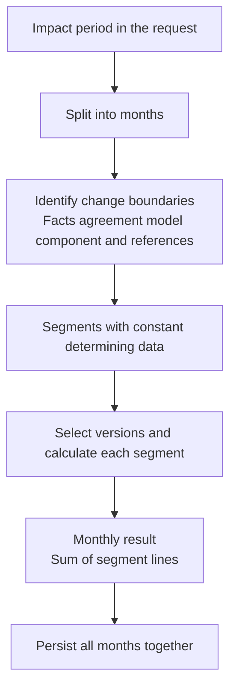

Example: A price changes on September 16. Two segments are created: September 1–15 and September 16–30. Each segment uses its effective price and receives a partial-month factor of 15 out of 30.

`From` and `To` in the request define the impact period supplied by the calling system, for example from the placement date through the end of the commitment year. The engine does not infer an end-of-commitment date that was not provided. The implementation limits a request to approximately five years.

### Proration in the Priced-Items Template

| Policy | Meaning |
|---|---|
| `calendar` | Segment days divided by the number of days in the month |
| `shortStay` | Segment days divided by 30.4167 |
| `activity` | Uses `facts.activityFactor` supplied for the segment |
| `none` | Factor of 1 for each item execution |

An item-level policy may override the component-level policy. The implementation does not build an organizational activity calendar; the factor is supplied externally.

**Decision required:** A one-time component or a `none` policy does not necessarily imply payment in every segment. Currently, a template executes in every segment to which it applies. Extending the system to one-time payments requires a payment-frequency contract and duplicate-execution prevention.

**Improvement point:** `PeriodPlanner` currently also considers boundaries of reference data that may not be relevant to the component. Unnecessary splits should be reduced, and their effect on rounding and non-prorated payments must be checked.

The default rounding policy is two decimal places, `AwayFromZero`, for each segment line. The monthly result is the sum of rounded lines. This POC policy requires business approval.

## Stage 12 Model Execution by Layers

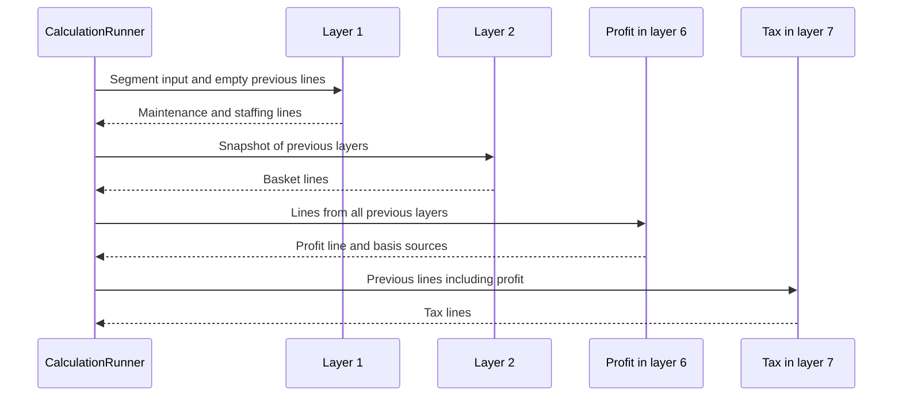

All components in a layer receive the same snapshot of lines completed before it. A component's results are not exposed to other components in the same layer. Only when the layer finishes are all of its results added to the temporary collection.

In the POC, components execute sequentially within a layer. The contract allows concurrency to be explored later, but it must not be claimed as already implemented.

Profit and tax applicability are carried on every output line. The profit template filters by profit applicability; the tax template filters by tax applicability and facts. Special basis types, such as gross salary versus employer cost, require an explicit contract and fields before incorporating the complete organizational tax rules.

A failure in any component in any month stops the event. A legitimate business zero is retained as a valid result; a missing price or failed assertion is a failure, not zero.

## Stage 13 Retroactive Recalculation and Adjustments

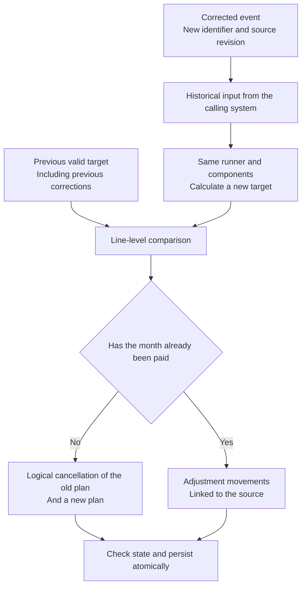

### One Mechanism for All Components

A component does not know it is executing retroactively and does not read transactions from earlier payments. It calculates a regular target using the selected input and definitions. `ResultComparer` compares the new target with the previous monthly state.

| State | Behavior |
|---|---|
| Month without a result | `Pending` movements are created |
| Pending month | Original movements remain; negative `Canceled` movements and new Pending movements are appended |
| Previously paid month | `Adjustment` movements are created for the difference only |

### Repeated Correction Example

1. First paid target: 100.
2. Corrected target: 110. An addition of 10 is created.
3. Another target: 115. An addition of 5 is created, not 15.

The second comparison uses the latest target run. Original movements and previous adjustments remain stored. `Settlement` records which movement identifiers were included when marking a payment; new differences do not automatically become paid. This marking is a demonstration only, with no banking or payment processing.

### Assembling Retroactive Input

The calling system supplies historical facts with the intended correction. Regular retroactive recalculation selects reference data from the current catalog according to the business date. A recalculation replacing only one reference-data value while preserving the rest of the catalog as it was historically is not currently implemented.

A departure may be represented by `active=false` in ineligible periods. Months that must be reduced to zero must also be included. Omitting a month from a request is not a cancellation request for that month.

**System-wide retroactive recalculation:** Identifying the population, approving impact, partitioning into batches, and resuming after failure are an extension stage. The current implementation handles retroactive recalculation for an individual event.

## Stage 14 Simulation and Impact Assessment

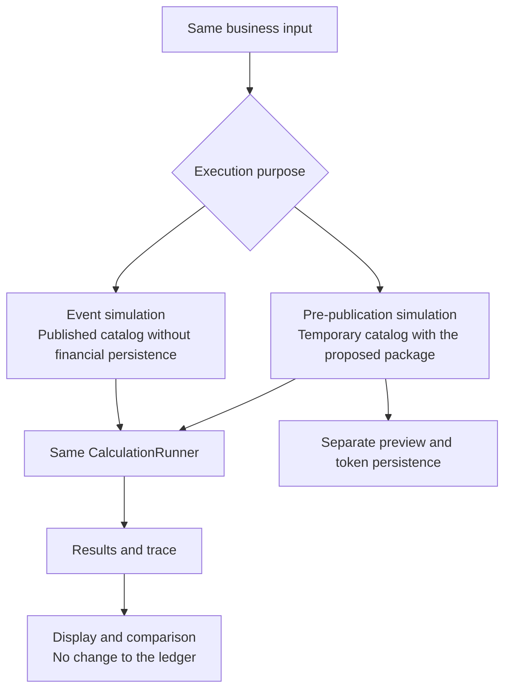

### Two Different Interfaces

- `POST /api/calculations/simulate`: Calculation using the published catalog, without persisting a payment. `ForcedAgreement` allows an agreement to be selected for simulation only.
- `POST /api/publications/preview`: Adds the package to a temporary catalog, executes test cases, and returns differences against stored monthly results, where present.

If no previous payment exists, preview differences are presented relative to zero; they do not always represent a comparison between the current and proposed models. Comparing X with X+1 without a stored result requires explicitly calculating both sides. No dedicated screen exists for this.

Analysis of models affected by a reference-data change is currently conservative: It may include more models than are actually affected because expressions can select reference data dynamically. There is no approved regression mechanism covering all hundreds of models as a publication prerequisite.

The implemented Sandbox is a logical execution path within the same server process. Separate resources and workload isolation are additional requirements.

## Stage 15 Atomic Persistence and Concurrency

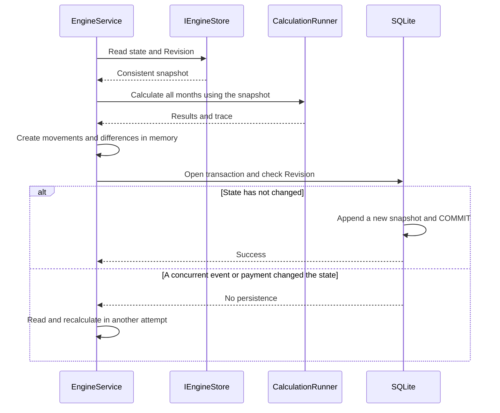

The calculation plan does not change during an execution attempt. Before persistence, the system checks that the state on which the calculation relied is still current. A state change causes recalculation, up to a limited number of attempts.

This prevents a transition from Pending to Paid from being overwritten based on an old read: If the marking is persisted while the event is being calculated, the commit attempt fails and the event is recalculated using the updated state.

### Existing Storage

`SqliteEngineStore` stores a `Snapshots` table containing the complete system state as JSON, a revision, a checksum, and a timestamp. UPDATE and DELETE are blocked by triggers. Transactions and trace are logically separated in the contracts but are not separate physical tables in the POC.

If the second month fails, no payments are persisted for the first month. A separate exception entry may be retained after failure without creating partial financial state.

### Storage Limitations

- Read, copy, and storage costs grow with the full history.
- Unrelated events may also compete over a global revision.
- The current checksum is not a signature protecting against a database administrator.
- The checksum is recomputed from deserialized objects; serialization-schema changes require handling to avoid rejecting valid history.

Production volumes require normalized storage, schema versioning, impact-analysis indexes, and processing coordination by the appropriate business key.

## Stage 16 System and File Map

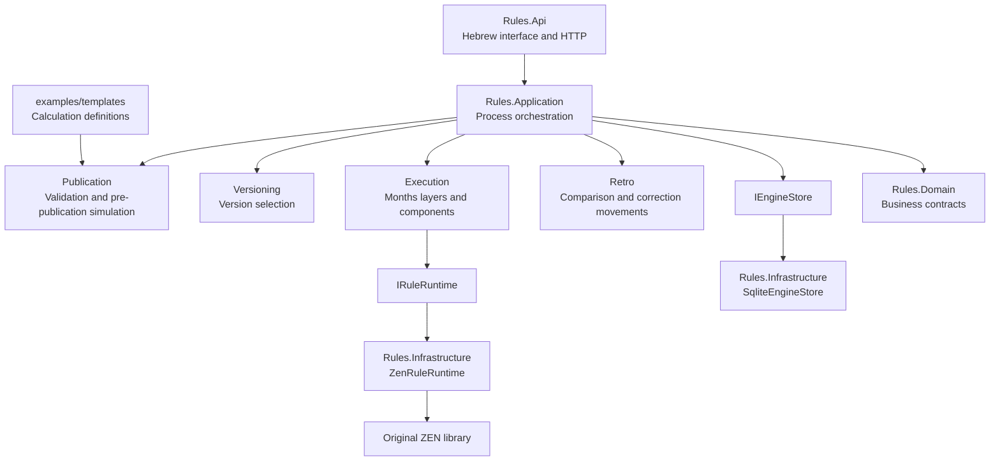

| Location | Responsibility | What does not belong there |
|---|---|---|
| `Rules.Domain/Definitions.cs` | Definitions, schemas, and events | Database and library access |
| `Rules.Domain/Results.cs` | Results, movements, and evidence | Rule execution |
| `EngineService` | Coordinating publication, calculation, and persistence | A dedicated formula for every component type |
| `Publication` | Package and table validity | Approval of the business agreement itself |
| `VersionResolver` | Version selection | Collection of adjustment amounts |
| `PeriodPlanner` | Month and segment boundaries | Inventing historical data |
| `CalculationRunner` | Layer order | Separate calculation code for every model |
| `ComponentExecutor` | Template protocol, steps, and output | Retrieval from external systems |
| `ZenRuleRuntime` | Compilation, expression and table execution, and SDK adaptations | Consent and payment management |
| `ResultComparer` | Previous target versus new target | Recomputing the component formula |
| `SqliteEngineStore` | Local atomic persistence | Business eligibility decisions |
| `examples/templates` | Declared rules and formulas | Automatic deployment merely because a file changes |
| `wwwroot` | Displaying and running POC scenarios | A complete business modeling system |

The project runs as one API process, not as a collection of microservices. Separation is between projects, contracts, and modules. During expansion, responsibilities within `EngineService` and `ComponentExecutor` should be split, rather than separating services without a demonstrated operational need.

## Stage 17 Required Generality and Extension Boundaries

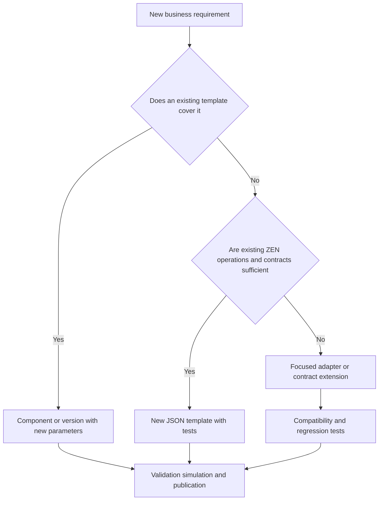

| Generality requirement | Existing mechanism | Boundary |
|---|---|---|
| Additional component without code | Template reference and parameters | Within the schema and permitted operations |
| Additional model without code | Component-use list and layers | Valid definitions and test cases are required |
| Component shared by multiple models | Version selection by ComponentId and date | Update impact requires business control |
| Different applicability conditions | ConditionEvaluator | Restricted, typed operator language |
| Changing condition columns | Schema for every table version | Fields must match the template facts contract |
| Multiple table matches | collect with an overlap policy | Does not replace a business decision about duplicate payment |
| Filtered and grouped basis | ForEach, GroupBy, and ZEN steps | No guarantee that every future algorithm is supported |
| Dependence on previous layers | previous in a uniform structure | No direct communication between components |
| Shared explanation mechanism | StepEvidence and a Hebrew template | Rejection details in regular filtering require an addition |
| Retroactive recalculation for every component type | Uniform-output comparison | Business key and payment frequency must be appropriate |

There is no need to implement all approximately 50 future component types now. Representative examples should nevertheless be checked against the contracts to ensure that generality is not based solely on the housing scenario.

## Stage 18 Verification and Work Required Before Expansion

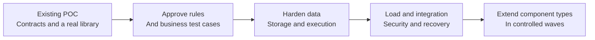

### What Has Been Demonstrated

The existing regression report contains 27 passing tests against real ZEN and SQLite. A separate additional feasibility test passed for grouping and a profit chain in ZEN when groups are known in advance. This document does not claim that all 28 tests were executed together in the same report.

Tests covered complete calculation, profit and tax bases, a table with multiple matches, dates, adding a component without code, a new emergency template, Pending replacement, repeated Paid adjustments, a mid-month change, leap-year February, duplicates and concurrency, second-month failure, stale publication, and retrieval after reopening the database.

The interface was tested with an original calculation of 7,226.32 and a corrected simulation of 7,717.20, publication, and then a correction event. These are illustrative data, not ministry-approved amounts.

### Recommended Order of Remaining Work

| Priority | Work item | Risk addressed |
|---|---|---|
| 1 | Approve the determining date, rounding, payment frequency, and comparison keys | Financial error despite technically working code |
| 1 | Complete the historical-input and single-source-correction contract | Unintended use of current data during retroactive recalculation |
| 1 | Add early validation and approved Golden Cases | Failure discovered only during a real calculation |
| 2 | Normalized storage and schema versioning | Snapshot growth and difficulty upgrading history |
| 2 | Reduce trace and data copying | Excessive storage and memory consumption |
| 2 | Cache eviction and resource controls | Calculation rejection after expressions accumulate |
| 2 | Strengthen expression safety according to trust level | Expensive or unauthorized expressions; the current policy is not a sandbox |
| 3 | Identities, roles, and viewing permissions | Data exposure or unauthorized publication |
| 3 | Load testing, backup and recovery, and separate Sandbox resources | Operational failures not examined in the POC |
| Extension stage | Publication withdrawal, system-wide retroactive recalculation, and durable batches | Broad corrections and controlled recovery |

Complete organizational tax rules, permission-based retrieval, banking settlement, system-wide retroactive recalculation, and publication withdrawal are not implemented. Synthetic data and local-access restrictions do not replace a security and production architecture.

### Working Links for the Architect and Team

- [Running the project](../README.md)
- [Definition contracts](../src/Rules.Domain/Definitions.cs)
- [Result and transaction contracts](../src/Rules.Domain/Results.cs)
- [Execution flow](../src/Rules.Application/Execution/CalculationRunner.cs)
- [ZEN library adapter](../src/Rules.Infrastructure/Rules/ZenRuleRuntime.cs)
- [HTTP interfaces](api-he.md)
- [Coverage and gaps](coverage-he.md)
- [Verification report](verification-he.md)
- [Grouping capability test](../tests/Rules.Tests/GroupingCapabilityTests.cs)

The requirements baseline is the POC document dated October 18, 2026, and the in-house development requirements document dated November 14, 2026, together with the clarifications in the conversation. Whenever a future design differs from the behavior described here, the contracts, tests, and this document must be updated together.
